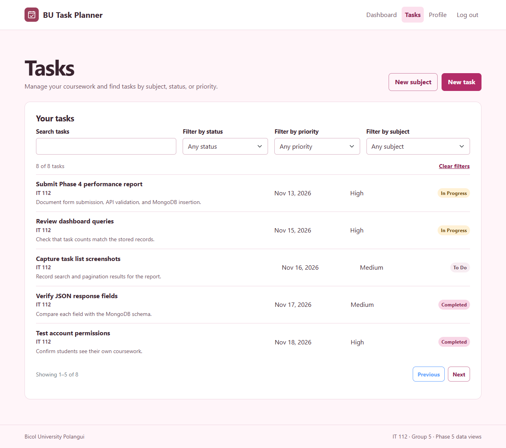

# BU Student Academic Task and Deadline Management System

IT 112 · Group 5 · BSIS-2B · Phase 5

[Phase 5 report](docs/lab13/Phase-5-Report.pdf) · [GitHub commits](https://github.com/kjamesss/Phase-5-Displaying-and-Managing-Data-on-the-Frontend/commits/main/) · [Phase 5 tag](https://github.com/kjamesss/Phase-5-Displaying-and-Managing-Data-on-the-Frontend/tree/phase-5)

## Run locally

Run `npm ci` with Node.js 22 or later. Copy `.env.example` to `.env`, set `MONGODB_URI` to your MongoDB connection URI, and set a random `JWT_SECRET` of at least 32 characters. Run `npm start` and open http://localhost:3000. For Live Server on port 5500, use the same hostname as the Express server on port 3000.

Register or sign in, add a subject or task, and open the dashboard or task list. An existing account with the database role `admin` opens the administration view after login. Public registration creates student accounts.

| GET endpoint | Access | Display |
| --- | --- | --- |
| `/api/session` | Signed-in user | Profile |
| `/api/tasks` | Task owner | Progress, deadlines, task cards, search, filters, and pagination |
| `/api/categories` | Subject owner | Subject choices and filter |
| `/api/users` | Administrator | Searchable, paginated account table |
| `/api/admin/tasks` | Administrator | Paginated coursework overview |

Tasks and subjects are the equivalents of the example product and order records. Search and pagination work on the records returned for the current account. The task list refreshes after insertion. The dashboard uses Philippine calendar dates.

`frontend/js/api.js` handles Fetch, JSON, and session cookies. `frontend/js/display.js` uses text nodes and shares a pagination helper between cards and tables. The `backend` folder contains API routes, Mongoose models, and integration tests.

## Evidence

Run `npm test` for the integration suite. Import the [Postman collection](docs/lab13/Phase-5.postman_collection.json) and fill in the base URL and classroom student and admin credentials. Login requests establish session cookies for later requests.

[Phase 5 evidence folder](docs/lab13/) · [Phase 4 report and evidence](docs/lab12/)

