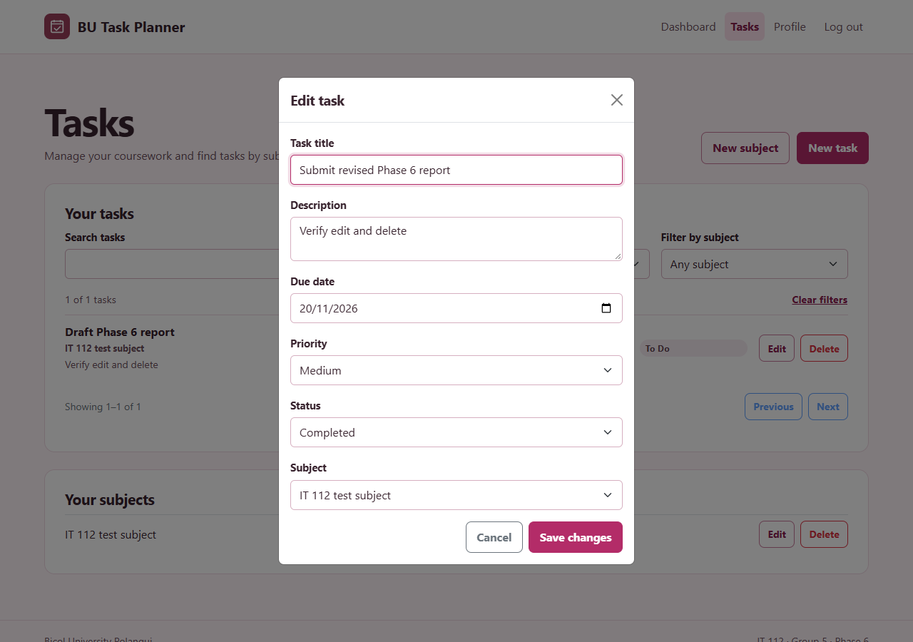

# BU Student Academic Task and Deadline Management System

IT 112 · Group 5 · BSIS-2B · Phase 6

[Phase 6 performance report](docs/lab14/Phase-6-Report.pdf) · [GitHub commits](https://github.com/kjamesss/Phase-6-Update-and-Delete-Functionalities/commits/main/) · [Phase 6 tag](https://github.com/kjamesss/Phase-6-Update-and-Delete-Functionalities/tree/phase-6)

## Run locally

Use Node.js 22 or later. Run `npm ci`, copy `.env.example` to `.env`, and set `MONGODB_URI` and a random `JWT_SECRET` of at least 32 characters. Run `npm start` and open http://localhost:3000. For Live Server, serve the frontend on port 5500 and use the same hostname as Express on port 3000.

Sign in and open Tasks to edit or delete a task or subject. Profile allows the signed-in account to edit its name and email. An existing administrator account opens Administration after login and can edit or delete eligible student accounts.

## Update and delete routes

| Method and route | Access | Behavior |
| --- | --- | --- |
| `PUT /api/tasks/:id` | Task owner | Validates task fields and any selected subject |
| `DELETE /api/tasks/:id` | Task owner | Removes the selected task |
| `PUT /api/categories/:id` | Subject owner | Updates subject name and optional display color |
| `DELETE /api/categories/:id` | Subject owner | Removes the subject and clears its references on the owner's tasks |
| `PUT /api/users/:id` | Account owner or administrator managing a student | Updates name and email |
| `DELETE /api/users/:id` | Administrator | Deletes a student account that owns no tasks or subjects |

The API validates IDs and submitted fields, scopes writes to eligible records, and returns JSON feedback. Task and subject writes and account deletion are serialized per owner within one Express instance. Account edits accept only name and email. Administrator accounts are protected from directory deletion. Subjects can be removed while preserving their tasks as uncategorized.

The interface uses a shared Bootstrap modal, prefilled controls, explicit delete confirmation, and the existing Fetch helper. It retains edits after a failed request and refreshes the saved list after success.

## Verification and evidence

Run `npm test` for the integration suite. Import the [Postman collection](docs/lab14/Phase-6.postman_collection.json), enter your base URL and lab administrator credentials, and run requests in order. The collection creates and deletes a disposable student account, task, and subject.

The [evidence folder](docs/lab14/) includes the edit and delete screenshots, MongoDB Atlas readback, Postman results, and GitHub history. The verification run used a separate Atlas lab database.

